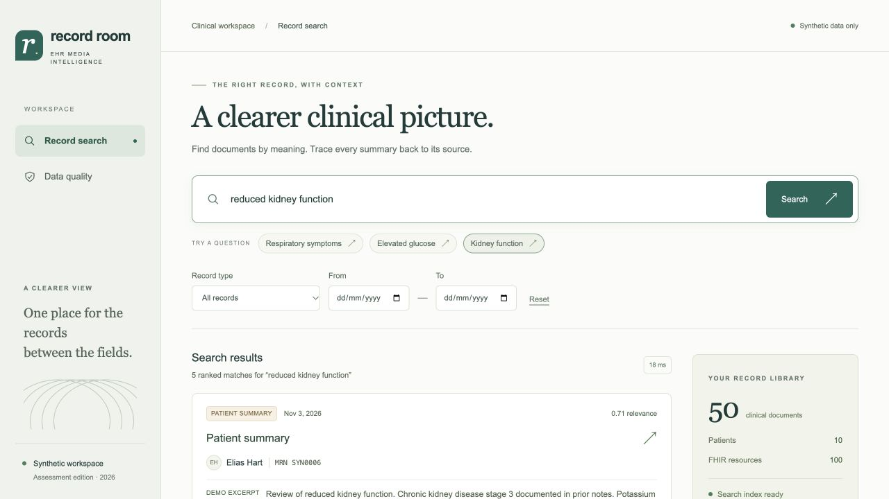

# Record Room · EHR Media Intelligence

A runnable assessment application that turns messy JSON/CSV exports into validated FHIR R4 bundles, source-linked clinical summaries and semantic search. **Every included patient and record is fictional.**

Python/FastAPI · Pydantic v2 · fhir.resources · SQLite · sentence-transformers · FAISS · HTML/JavaScript · compiled Tailwind CSS



## Run locally

Use **Python 3.11 or 3.12** (tested on 3.12.14). Run commands from this repository's root. The first ingestion downloads the roughly 90 MB MiniLM embedding model; subsequent runs can use the cached model offline. No Node installation is needed to run the checked-in UI.

```bash
python3.12 -m venv .venv
source .venv/bin/activate
python -m pip install -r requirements.txt
cp .env.example .env

# Labeled, deterministic excerpts; no API key needed for this walkthrough.
python -m ehr_media.cli ingest --summary-provider demo
python -m uvicorn ehr_media.api:app --host 127.0.0.1 --port 8000
```

Open http://127.0.0.1:8000. Interactive API documentation is at `/docs`.

On Linux, installing a CPU-only PyTorch wheel first avoids unnecessary CUDA packages:

```bash
python -m pip install torch==2.2.2 --index-url https://download.pytorch.org/whl/cpu
python -m pip install -r requirements.txt
```

The application is designed to run from a source checkout, not as a standalone wheel. The model is initialized and warmed once at server startup. `/health` returns HTTP 503 until the index is ready. Stop the server before re-importing and restart it afterward; imports replace the complete local dataset.

### Enable real OpenAI summaries

Add a funded API key to the local, Git-ignored `.env` file:

```dotenv
OPENAI_API_KEY=your-key-here
OPENAI_MODEL=gpt-4.1-mini
SUMMARY_PROVIDER=openai
```

```bash
python -m ehr_media.cli ingest --summary-provider openai
python -m uvicorn ehr_media.api:app --host 127.0.0.1 --port 8000
```

The importer makes one structured Responses API request per uncached patient. It uses `store=False`, a 40-second timeout and bounded SDK retries. Errors or refusals stop the import rather than silently switching to demo data. Successful summaries are cached by patient ID, canonical bundle hash, provider, model and prompt version. Re-running unchanged data makes no additional summary calls. The frontend labels live output **AI summary** and offline output **Demo excerpt**.

**Live-provider verification:** no API key was available during initial development. The actual OpenAI SDK adapter is exercised with an HTTP mock, including strict-schema requests, refusals and upstream failure. Demo excerpts are not evidence that live model output is clinically correct. Use `docs/summary-review.md` when enabling a real key.

## Walkthrough

1. Search for **low blood count and depleted iron stores**. Leila Mercer's anemia records should appear near the top even though the query differs from their wording.
2. Choose **Diagnostic reports** and a date range. Filtering happens before the top-five cutoff.
3. Open a result. Inspect the four summary sections and use **View source** to check an exact FHIR document.
4. Select **Patient summaries** to search the summary embeddings; **Reset** returns to recent documents.
5. Open **Data quality**: the fixture contains 55 input rows, 50 accepted documents, 1 duplicate and 4 quarantined rows across 10 patients.

Scores are cosine similarity in `[-1, 1]`, not probabilities or clinical confidence. The backend returns the top five eligible records, even for a weak query. A patient may have several relevant records; the same underlying document is deduplicated across DocumentReference/DiagnosticReport representations unless a type is explicitly selected.

## Pipeline and design decisions

```text
JSON + CSV -> Pydantic cleaning / audit -> Patient-specific FHIR R4 Bundles
                                      -> SQLite + content-keyed summaries
                                      -> token-aware chunks -> MiniLM -> FAISS
Browser -> POST /search + filters -> ranked records -> patient / source drawer
```

| Assessment task | Implementation | Main evidence |
| --- | --- | --- |
| Ingest and clean | `ehr_media/ingestion.py`, `models.py` | Missing values, date normalization, duplicates and identity-conflict tests |
| FHIR R4 mapping | `ehr_media/fhir.py`, `store.py` | Three required resources plus Encounter; exact R4 schema and reference checks; HL7 validator report |
| AI summarization | `ehr_media/summaries.py` | OpenAI structured output, evidence/word-limit gates, cache invalidation, provider-error tests |
| Semantic search | `ehr_media/search.py`, `api.py` | All document/report text and summaries embedded; real-model retrieval test and latency benchmark |
| Search UI | `web/` | Responsive desktop/mobile views, keyboard-operable native dialogs, loading/error/empty states |

**Cleaning.** MRNs are uppercased and stripped of whitespace/hyphens while retaining leading zeroes. Records are grouped only by exact normalized MRN, never by name similarity. Contradictory known demographics or one external patient ID pointing at multiple MRNs quarantine all affected rows. A conflicting source record ID also quarantines all versions. Missing demographics remain unknown; a missing MRN or empty document is rejected. Consistent same-MRN records can fill missing demographics with an audit entry. Deduplication uses canonical patient/date/kind/text. The policy assumes one source namespace; production requires source-system-qualified identifiers.

**Dates.** Accepted formats are ISO `YYYY-MM-DD`, explicitly US `MM/DD/YYYY`, `YYYY/MM/DD`, and `DD-Mon-YYYY`. Ambiguous slash dates follow the documented US export convention; they are not guessed from host locale. Unknown dates remain null and are excluded by date filters. Date-only sources populate `Attachment.creation` or `DiagnosticReport.effectiveDateTime`; they do not become invented timestamps in `DocumentReference.date`.

**FHIR.** Bundles use `type: collection`, stable IDs, unique UUID URN `fullUrl` values and resolvable `subject`/`encounter` references. All DomainResources contain escaped human-readable XHTML narratives. Unknown encounter class uses the standard data-absent-reason extension. No medical code or report status is inferred from a note. `fhir.resources` 8 supports R4B, not R4, so its Python models are only the first check; the vendored official **R4 4.0.1** schema is applied independently. App-level checks enforce one patient per bundle, unique URLs, same-patient subjects and correctly typed encounters. The HL7 validator additionally checks base profiles and invariants. Terminology-server validation is disabled in the recorded run and this limit is reported explicitly.

**Summaries.** The LLM selects complete sentences or lines from documents instead of inventing prose. The server rejects unknown source IDs, altered numbers, unsupported excerpts, fragments that strip sentence context, and output of 200 words or more (including the disclaimer and confidence text). Null/empty fields mean not documented, not a negative finding. Source matching reduces hallucination risk; it does not prove that selection or interpretation is clinically correct. No treatment recommendations are generated. Histories over 80,000 characters are rejected rather than silently truncated.

**Search.** A local `all-MiniLM-L6-v2` model embeds token-aware 192-token chunks with 32-token overlap. DocumentReference text, DiagnosticReport text and patient summary evidence are all indexed. FAISS exact inner-product search over normalized vectors yields cosine scores. The complete small corpus is ranked, then filtered and deduplicated before taking five matches. SQLite and the FAISS manifest are tied by a corpus hash; stale/mismatched snapshots fail closed on startup. Re-importing is an offline operation, not a concurrent live-update API.

**UI.** Same-origin Fetch requests call FastAPI. A 320 ms debounce and request cancellation avoid outdated responses replacing newer searches. API strings are inserted with `textContent`, not interpreted as HTML. Labels, status announcements, visible focus rings, native-dialog focus trapping/Escape, reduced-motion handling and mobile layouts support accessibility. Source links open actual stored resources in a new tab.

## Input and API contracts

JSON accepts an array of objects or `{ "records": [...] }`. Demographics may appear at the top level or in a `patient` object. CSV uses the same top-level field names. The included CSV simulates text already extracted from scanned notes; OCR and PDF parsing are out of scope for this implementation.

```json
{
  "record_id": "example-doc-1",
  "patient_id": "external-patient-1",
  "mrn": "SYN-0001",
  "name": "Example Person",
  "dob": "1980-01-20",
  "gender": "F",
  "date": "2026-10-15",
  "kind": "lab",
  "title": "Laboratory report",
  "encounter_id": "example-visit-1",
  "text": "Finding: Hemoglobin 12 g/dL."
}
```

`kind` is `note`, `lab`, `imaging` or `discharge`. MRN and non-empty text are required; invalid dates and future DOBs are rejected. Optional identifiers remain absent when not supplied.

```bash
python -m ehr_media.cli ingest data/synthetic/ehr_export.json data/synthetic/scanned_notes.csv --summary-provider demo
curl -X POST 'http://127.0.0.1:8000/search?resource_type=DiagnosticReport&date_from=2026-10-01&date_to=2026-10-31' \
  -H 'Content-Type: application/json' \
  -d '{"query":"low hemoglobin and fatigue"}'
```

`POST /search` accepts `{ "query": "..." }` (2-500 characters) and optional query parameters `resource_type`, `date_from`, `date_to`. Supported types are `DocumentReference`, `DiagnosticReport`, `Patient`. Dates are inclusive ISO dates; a reversed range returns 422. Results include patient name/MRN, resource ID/type/date, title, cosine score, summary snippet and summary provider. Other routes: `GET /records`, `/stats`, `/health`, `/patients/{id}`, `/patients/{id}/bundle`, and `/patients/{id}/resources/{type}/{id}`. Unknown patients/resources return 404; an unavailable index returns 503.

## Verify and reproduce

```bash
pytest
# Real downloaded model, after ingesting the bundled fixtures:
RUN_EMBEDDING_TESTS=1 HF_HUB_OFFLINE=1 TRANSFORMERS_OFFLINE=1 pytest
python -m ehr_media.cli benchmark --runs 25
# Only needed when changing frontend styles:
npm ci
npm run build:css
npm run check:js
```

The ordinary test suite needs neither an API key nor a model download; its encoder double tests mechanics, not semantic quality. The optional integration test uses the real MiniLM model and three paraphrased retrieval queries. `docs/verification.md` records tested behavior and boundaries. `docs/benchmark.json` contains measured local warm-request timings; cold model download/loading and remote network latency are excluded.

Generated files under ignored `runtime/`: `cleaned.json` (records and per-row audit), `validation.json` (paths/messages), `bundles/*.json`, `ehr.sqlite` (bundles and summary cache), `index/` (FAISS vectors/manifest), `models/`, `report.json` and `benchmark.json`. Regenerate fixtures with `python scripts/generate_synthetic.py`.

For the independent HL7 validator, download the official `validator_cli.jar` and run:

```bash
java -jar validator_cli.jar runtime/bundles -version 4.0.1 -tx n/a -output runtime/hl7-validation.json
```

Java 17 and validator 7.0.5 were used. This downloads HL7 packages; `-tx n/a` disables a remote terminology server. Production validation should also apply the receiving organization's implementation guides and terminology service.

## Scope and next steps

This is a single-user synthetic assessment app. It does not integrate with Epic, parse PDFs/OCR, implement SMART-on-FHIR/OAuth, provide access controls or consent, encrypt the store, or perform clinical validation. Bind it to loopback and do not import real patient data. Before production: qualify identifiers by source system; introduce auth/authorization and protected audit storage; add clinician-led summary/retrieval evaluation (including negation, temporal conflicts and missing context); run terminology/profile validation; add atomic versioned imports, background jobs and an index suited to larger corpora. Generic MiniLM is not clinically validated and can rank negated or unrelated records highly.

## Research references

- [FHIR R4 DocumentReference](https://hl7.org/fhir/R4/documentreference.html), [DiagnosticReport](https://hl7.org/fhir/R4/diagnosticreport.html), and [validation coverage](https://hl7.org/fhir/R4/validation.html)
- [fhir.resources supported versions](https://github.com/nazrulworld/fhir.resources)
- [Sentence Transformers encoding](https://sbert.net/docs/package_reference/sentence_transformer/SentenceTransformer.html)
- [OpenAI structured outputs](https://developers.openai.com/api/docs/guides/structured-outputs)
- [Official HL7 validator](https://github.com/hapifhir/org.hl7.fhir.core)

See `docs/assessment-writeup.pdf` for the one-page submission write-up. Development used AI assistance; the repository includes runnable checks and documents the boundaries of what was actually verified.
